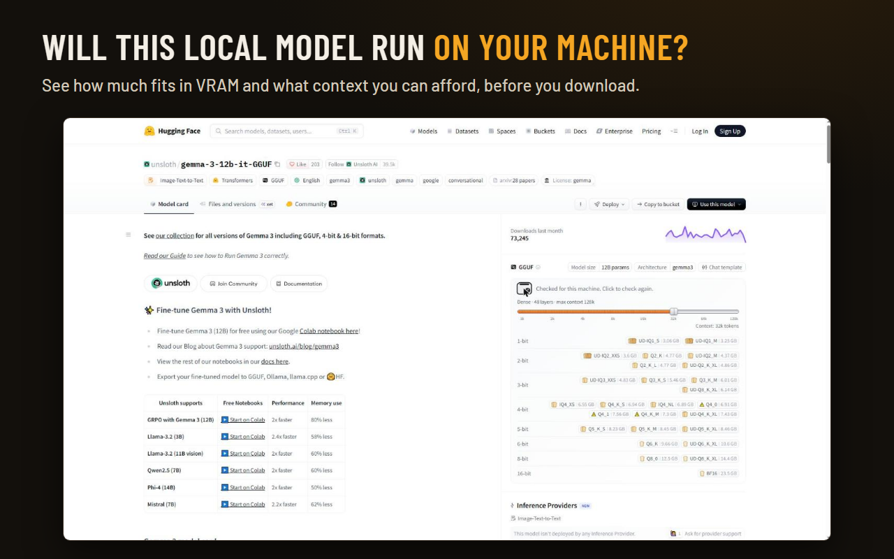
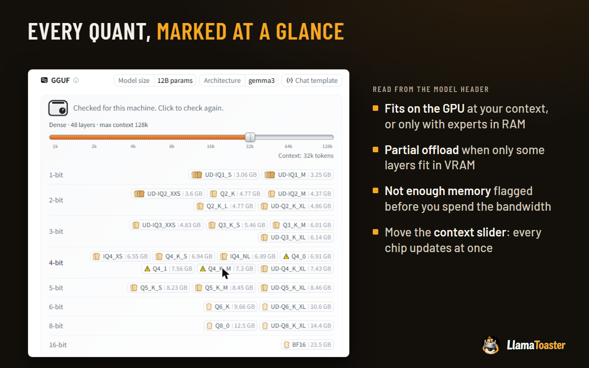
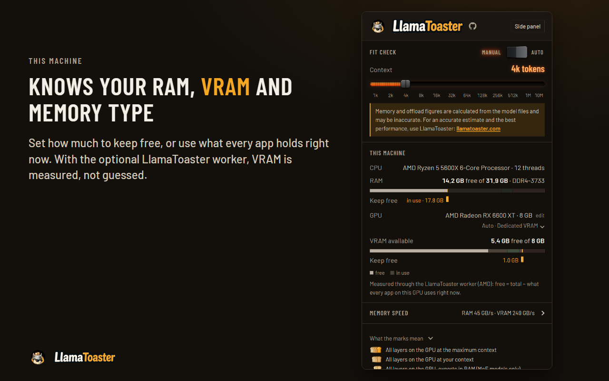

# LlamaToaster for Chrome

A browser extension for [LlamaToaster](https://github.com/LlamaToaster/LlamaToaster) that answers **"will this local model run on my machine?"** on Hugging Face model pages, before you download anything: how many layers fit in VRAM, what goes to RAM, and what context you can afford. It uses the LlamaToaster web app's own fit logic and marks, so the extension and the Models page give the same answer for the same file.



Works in Chromium browsers (Chrome, Edge, Brave). It runs only on `https://huggingface.co/*`, has no server and sends nothing anywhere: see the [privacy policy](store/PRIVACY_POLICY.md).

## What you get

### On Hugging Face model pages

The "Hardware compatibility" heading above the GGUF quants becomes **"Will it fit? Click the toaster to check."** in Hugging Face's own style, with the toaster icon next to it.

- **Manual** mode (default): nothing is read until you click the toaster. **Auto** mode checks every GGUF page as it opens.
- While the headers are read, the toaster's dial turns and the line says how far it is ("Toasting… read 2 of 26 quants"). When done it reads "Checked for this machine. Click to check again."
- Under it: what the model is (`Dense` or `MoE`, layer count, **max context**, from the header) and a **context slider** on the page. It is the same setting as the popup's slider; moving either moves the other, and every chip is re-marked at once.
- Each quant chip gets a **bread mark** in place of Hugging Face's icon. Hover it for the figures: VRAM and RAM needed against what is available (and how much is kept free), layers on the GPU, KV cache and compute buffer, the context checked, file size and parts.

### The marks

The scale depends on the machine. A GPU with its own VRAM, or fast unified memory (Apple silicon, Strix Halo, GB10), is graded 0 to 5:

| Grade | Meaning |
|---|---|
| 5 | All layers on the GPU at the model's maximum context |
| 4 | All layers on the GPU at your context |
| 3 | All layers on the GPU, MoE experts in RAM (MoE models only) |
| 2 | Partial offload: half the layers or more on the GPU |
| 1 | Partial offload: under half the layers on the GPU |
| 0 | Not enough memory |

CPU-only machines and integrated GPUs on ordinary DDR (where the GPU barely helps decoding) are graded on RAM alone: 2 fits in RAM at the maximum context, 1 fits at your context, 0 not enough memory. The popup has a **What the marks mean** legend that shows the scale in use.



### The popup

Click the toolbar button. The **Side panel** button docks the same page in Chrome's side panel (the toolbar button then opens the panel); **Use popup** undoes it.

- **Fit check**: the Manual / Auto lever, the context slider (1k to 10M tokens, capped at each model's maximum), and a note that the figures are estimates.
- **This machine**:
  - CPU and thread count; RAM free and total, with its **type and speed** (e.g. `DDR4-3733`) when a worker reports them.
  - GPU name and VRAM size (**edit** to override), and the **memory type**: Auto (shows what it detected), Dedicated VRAM, Unified (shared RAM), or CPU only.
  - **VRAM available** (free of total) and a bar for RAM and for VRAM. With a worker, the bar splits into the apps holding the memory.
  - **Keep free**: a lever under each bar sets how much memory the model must leave alone. Any amount from 0 to everything usable, in 0.1 GB steps, with a pull onto the presets (RAM 0 / 2 / 4 / 6 / 8 GB, VRAM 0 / 0.5 / 1 / 1.5 / 2 GB), every whole GB, and **in use now**: what all apps hold when a check starts, captured once so the marks don't move afterwards.
  - Without a worker the browser cannot see what other apps use, so the whole card counts as free; the note under the bar says so.
- **What the marks mean**: the legend.



## How it sizes a model

1. It lists the repo's files and matches each chip to its `.gguf`. For a split model, that is shard 1 plus every other part.
2. It reads only the GGUF header (metadata and tensor list) with HTTP range requests, **2 MB per request**, and stops where the header ends. That is about 6 MB for a typical file and never touches the weights. Headers are cached in `chrome.storage.local`, so a page you open again shows its marks straight away.
3. It runs the same code as the app (`shared/` here is a copy of the app's, see [shared/README.md](shared/README.md)): `shared/gguf.ts` parses the header, `shared/fitSimulate.ts` places the model the way `llama-fit-params` does (output layer and blocks onto the GPU, MoE experts moved to the CPU first), `shared/fitLevel.ts` picks the level and `shared/fitGrade.ts` the bread grade.

The KV cache is sized as **f16**, and the context is capped at the model's own maximum (the header's `context_length`). Requests carry your Hugging Face cookies, so gated repositories you can open are readable too.

## What a browser can't see

- **Free VRAM.** No browser API reports VRAM (unless a worker is installed, see below). The total comes from a table of known cards (override it in the popup; a GPU not in the table asks for the size). Without a worker, "available" is the whole card.
- **Unified memory** is detected from the GPU name: Apple, Intel iGPU, Radeon integrated graphics. Apple silicon gets about 3/4 of RAM, like Metal's working-set budget. Override the memory type in the popup.

## Measured VRAM through the worker

Chrome reads VRAM internally but gives extensions no way to get it. A LlamaToaster worker on the same machine fills the gap: its installer and updater register [`worker/chrome-host/`](https://github.com/LlamaToaster/LlamaToaster/tree/main/worker/chrome-host) (in the app repo) as a Chrome native-messaging host, and Chrome starts it on demand whenever the extension asks. The worker service doesn't have to be running, and the order doesn't matter (worker first or extension first). A worker installed before this existed picks it up on its next update.

| OS | Source | GPUs |
|---|---|---|
| Windows | DXGI (total per adapter) + `GPU Adapter Memory` counters (live usage, all processes) | Intel, AMD, NVIDIA, Qualcomm, any WDDM GPU |
| Linux | DRM sysfs (`mem_info_vram_*`, xe tile VRAM, i915 `lmem_*`), `nvidia-smi` | AMD, Intel Arc, NVIDIA |
| macOS | `sysctl hw.memsize` + `vm_stat` | Apple silicon (unified) |

Only the extension's ID may call the host. The same host reports the installed RAM's type and speed (Windows: `Win32_PhysicalMemory`; macOS: `system_profiler`; Linux: `dmidecode`, which usually needs root, so Linux shows no type) and the apps using the most GPU memory, shown in the popup's bars and never stored. With it, the popup marks VRAM as **measured**, and "free" is the total minus what every app on that GPU uses right now. Integrated GPUs (512 MB carve-out or less) are treated as unified memory. Without a worker, everything falls back to the estimate, and the popup links to the worker install commands.

## Install

The extension is not on the Chrome Web Store yet; build it and load it unpacked:

```bash
npm install
npm run build      # -> dist/
```

Open `chrome://extensions`, turn on Developer mode, click **Load unpacked**, and pick `dist/`. To pick up a rebuild, click the reload icon on the extension's card.

The unpacked build carries a `key` in `manifest.json`, which fixes its ID so the native-messaging host (registered by the worker) accepts it.

## Develop

```bash
npm run watch        # rebuild on change
npm run typecheck
npm test             # vitest
npm run package      # Web Store zip -> store/build/llamatoaster-<version>.zip
npm run sync-shared -- ../LlamaToaster   # refresh shared/ from a local app checkout
```

- `shared/` is a copy of the app's, never edited here. The **Sync shared** workflow opens a pull request when the app's `main` differs.
- **Build** (CI) runs typecheck, tests and `npm run package` on every push and pull request.
- `npm run package` builds the store package: no `key`, no source maps, forward-slash paths, and a check that every file the manifest and pages refer to is in the zip.

## Chrome Web Store

Everything for the submission is in [`store/`](store):

- [LISTING.md](store/LISTING.md): store text, permission justifications, data-usage answers, reviewer notes, and the extension-ID steps (the store assigns its own ID, so the native-messaging host has to learn it).
- [PRIVACY_POLICY.md](store/PRIVACY_POLICY.md): the privacy policy.
- `media/`: icon, screenshots and promo tiles. The screenshots are real captures (`media/source/`) laid out by `node store/make-media.mjs` (needs `npm run build` for the fonts and a local Chrome).

## License

MIT, see [LICENSE](LICENSE).
